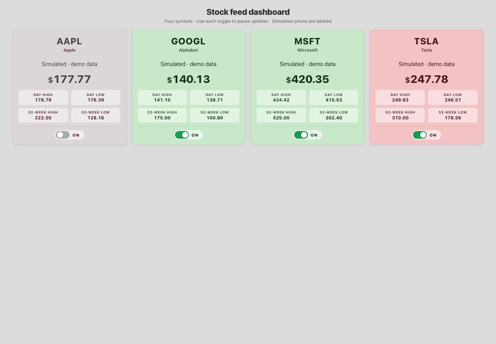
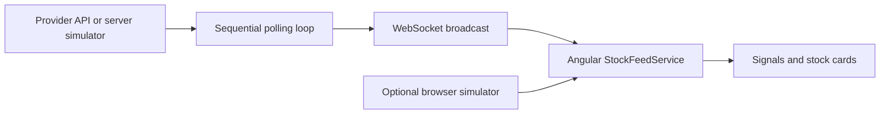

# Stock feed dashboard

Four Angular cards display AAPL, GOOGL, MSFT and TSLA quotes delivered by a small Node WebSocket server. This is a local dashboard demonstration: without a provider key, every price and range is simulated. Each card identifies its source, including simulated fallback when a provider request fails.



## Try the demo

Use Node 22 and two terminals from the repository root:

```sh
cd server
npm ci --ignore-scripts
npm start
```

```sh
npm ci --ignore-scripts
npm start
```

Open http://localhost:4200. The server binds to `127.0.0.1:8080`; both Angular environments use `ws://127.0.0.1:8080`. `PORT` changes the server port; update the matching environment URL too. Setting `useMock: true` in the selected Angular environment runs the random walk entirely in the browser.

For provider-backed quotes, supply `FINNHUB_API_KEY` only to the server process. Never put it in Angular source. The server polls quotes and caches available 52-week metrics for an hour. Missing provider ranges display **Unavailable**, rather than estimated market statistics. Quote failure falls back to a clearly labeled simulated card. Provider availability, account permissions and data freshness have not been verified with a live key.

## Reading the cards

- Use the ON/OFF button to freeze a card; resume to show the latest received quote. Pausing does not unsubscribe the WebSocket or stop provider polling.
- Green/red indicate movement relative to the preceding received price, falling back to previous close when unchanged. Paused cards use muted styling.
- The server simulator jitters around fixed example prices; the browser simulator walks from its previous tick. Neither is deterministic or historical market data.
- Small screens show day ranges; wider layouts also show 52-week ranges. [Mobile preview](docs/screenshots/mobile.png) uses synthetic data.

## How updates travel



Polling waits for the previous batch to finish, with a minimum one-second delay (`POLL_INTERVAL_MS`, default five seconds). Individual HTTP requests time out after five seconds. The Angular feed reconnects after disconnects and is stopped when the app is destroyed.

## Verification and limits

```sh
npm run build
npm test -- --watch=false --browsers=ChromeHeadless
```

Four Chrome tests cover app rendering, simulated-source labels, unavailable ranges and frozen/resumed prices. A separate Chrome browser check exercised the real local WebSocket with no provider key, pause/resume, and desktop/390px layouts; the screenshots above come from that synthetic run.

There is no authentication, trading, persistence, subscription management or production deployment configuration. There is no visible connection-age indicator yet, so a disconnected card can retain its last quote. Before hosting, add authenticated transport, WSS, origin restrictions, payload validation and explicit stale/disconnected status. This project is a UI/feed demonstration, not a source of trading decisions.
